# Manual de uso — aplicativo desktop e site gEEstor (v4.3)

Este manual cobre as duas formas de trabalhar com as faturas de **energia** (Equatorial, CHESP e borderôs) e de **água**
(Saneago e concessionárias municipais):

1. o **aplicativo desktop** *Processador de Faturas de Energia* (Windows), que transforma PDFs em planilhas Excel na sua
   máquina — sem internet, sem banco de dados;
2. o **site gEEstor** (https://unigeestor.emc.ufg.br), que guarda tudo num banco PostgreSQL na VM (uma organização por banco),
   mostra as faturas e a conferência, gera planilhas, recebe PDFs novos e alimenta o Power BI. (O bot do Telegram
   @doc_gEEstor_bot, que fazia esse papel, foi desativado em 12/11/2026: tudo é feito no site.)

As capturas de tela são do aplicativo real na versão 4.0.0 (16/09/2026).

---

## Parte 1 — Aplicativo desktop

### 1.1 Instalar e abrir

1. Baixe a versão mais recente em **Releases** do repositório
   ([github.com/ArturXCX/processador-faturas-energia/releases](https://github.com/ArturXCX/processador-faturas-energia/releases)):
   * `FaturasDeEnergia-Setup.exe` — instalador (recomendado; cria atalhos, não pede administrador), ou
   * `FaturasDeEnergia.zip` — versão portátil (extraia a pasta e abra `FaturasDeEnergia.exe`).
2. Rode o instalador a partir do **disco local** (não direto do Google Drive) — é bem mais rápido.
3. Não precisa de Python nem de Tesseract: o OCR já vem embutido (indicador **● OCR pronto** no canto superior direito).

### 1.2 Atualização obrigatória

Ao abrir, o aplicativo consulta a última versão publicada nas Releases do GitHub. Se houver uma versão mais nova, aparece
o aviso abaixo e o aplicativo fica bloqueado até você baixar e instalar a nova versão (botão **Baixar nova versão**; **Ver
no GitHub** abre a página da release; **Sair do aplicativo** fecha).

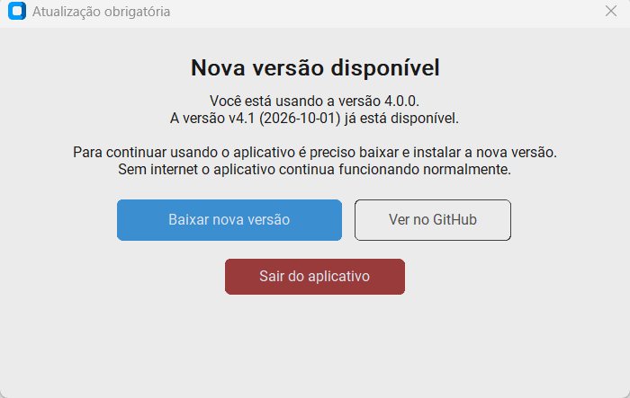

**Sem internet o aplicativo continua funcionando normalmente** — a verificação só bloqueia quando consegue confirmar que
existe versão mais nova. (Para quem faz capturas de tela ou testes: a variável de ambiente `FATURAS_SEM_ATUALIZACAO=1`
desliga a verificação.)

### 1.3 A janela principal

A tela tem dois **domínios** (abas de cima): **Energia Elétrica** e **Água**. Dentro de Energia Elétrica há o seletor
*Faturas de Energia / Borderôs de Energia*; cada conjunto tem as suas abas.

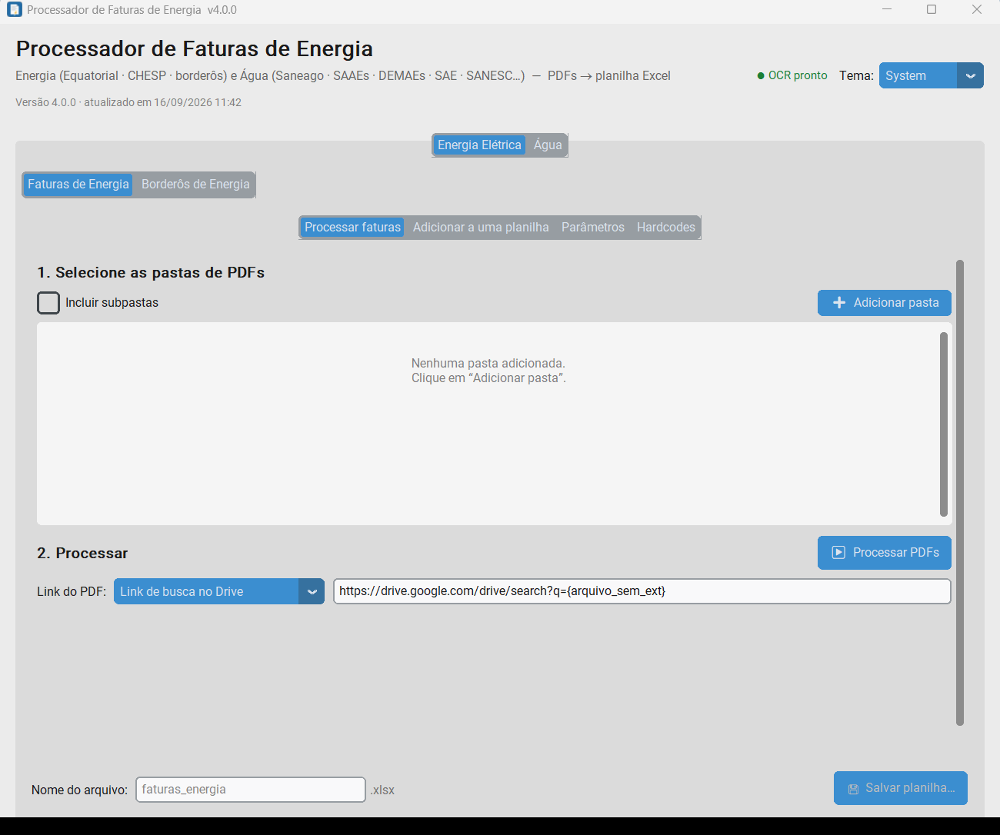

No canto superior direito ficam o indicador do OCR e o **tema** (System / Light / Dark). A versão e a data da build
aparecem sob o título.

### 1.4 Energia — Processar faturas

1. **Adicionar pasta**: escolha a pasta com os PDFs e informe a fornecedora (EQUATORIAL ou CHESP) em cada pasta adicionada.
   Marque *Incluir subpastas* se os PDFs estão separados por ano.
2. **Mapa de UCs (opcional)**: importe o dicionário de unidades consumidoras (JSON/xlsx) para preencher `id_uc_canonico`,
   unidade institucional, comarca etc.
3. **Link do PDF**: como preencher a coluna `link_pdf` (busca no Google Drive pelo nome do arquivo, caminho local ou modelo
   de URL).
4. **Processar** — a barra de progresso mostra o andamento; PDFs digitalizados (CHESP) passam por OCR e demoram mais.
   O log embaixo lista o que foi lido e os avisos da validação.
5. **Salvar planilha…** — escolha o nome e a pasta. A planilha sai com as abas `fatura_resumida`, `fatura`,
   `unidade_consumidora`, `itens_fatura`, `tarifas`, `impostos`, `medicao`, `medicao_resumida`, `validacao` e `glossario`.

O botão *Editar colunas* permite renomear/ocultar colunas e abas; esse "perfil" vai gravado numa aba oculta da planilha
e é respeitado quando você adiciona faturas novas depois.

### 1.5 Energia — Adicionar a uma planilha

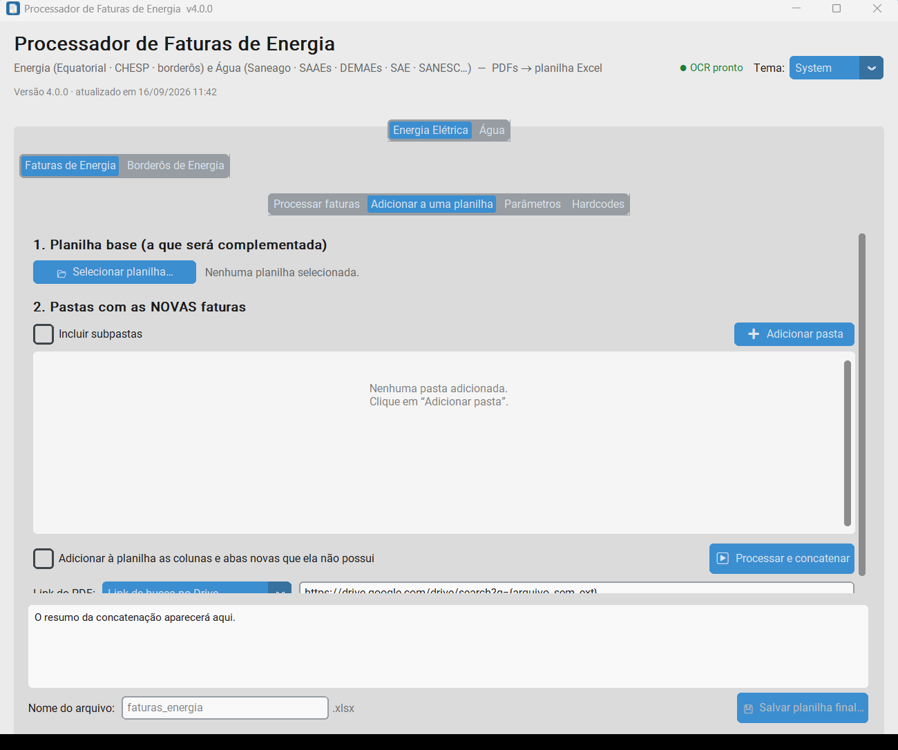

1. **Selecionar planilha…**: a planilha base (uma que o próprio app gerou, mesmo que você tenha renomeado colunas).
2. **Adicionar pasta**: as pastas com os PDFs **novos**.
3. **Processar e concatenar**: as faturas novas são traduzidas para o layout exato da planilha base e as repetidas
   (mesmo `id_fatura`) são descartadas. O resumo mostra quantas linhas entraram em cada aba.
4. **Salvar planilha final…**.

Se a planilha base não veio do app (sem metadados), o app sugere o mapeamento das colunas e abre uma tela de confirmação.

### 1.6 Energia — Parâmetros e Hardcodes

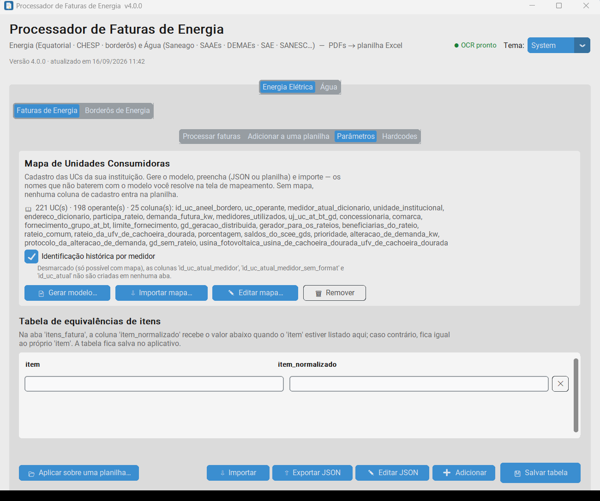

**Parâmetros** edita, em JSON, as listas usadas pela extração (itens informativos, equivalências de nomes de itens,
regras de validação…). **Hardcodes** cadastra regras *SE → ENTÃO* aplicadas só na planilha de saída (por exemplo,
corrigir uma classificação tarifária impressa errada numa UC específica).

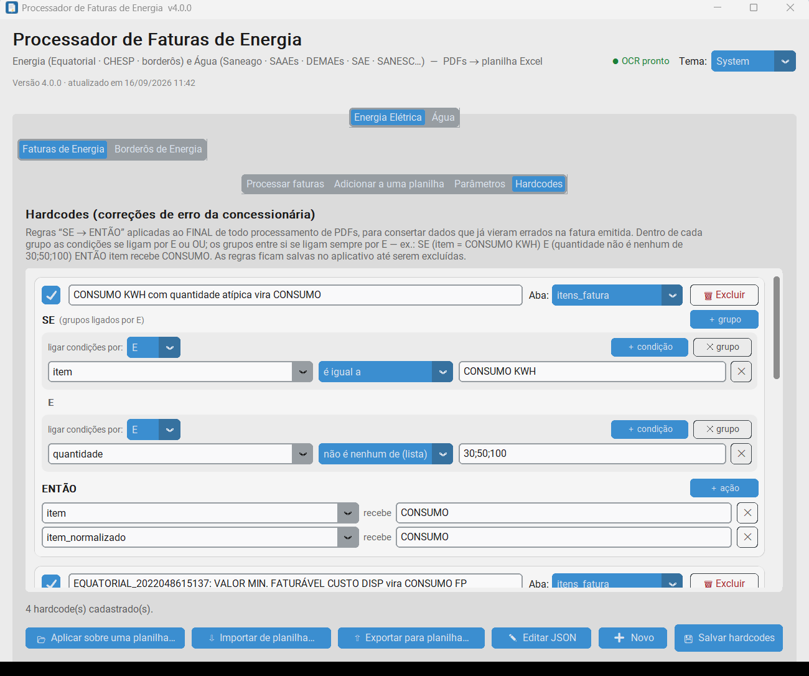

### 1.7 Energia — Borderôs

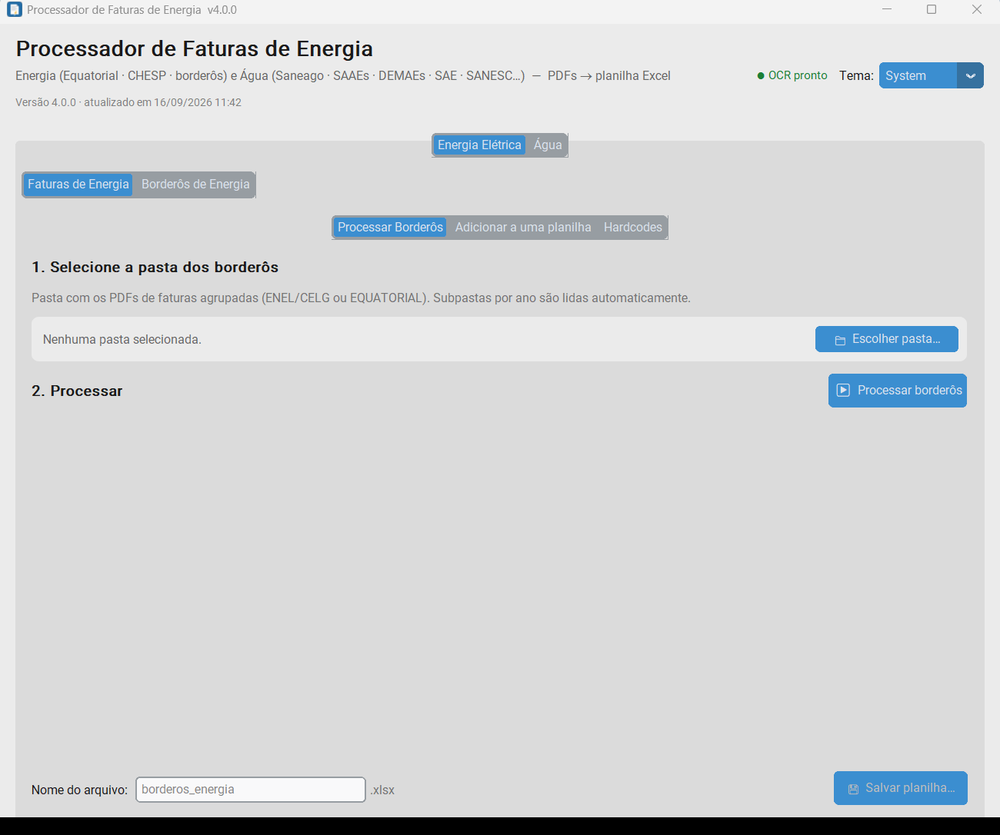

Selecione a pasta dos borderôs (faturas agrupadas da Equatorial/ENEL — subpastas por ano são lidas automaticamente) e
clique em **Processar borderôs**. Para cada borderô o log mostra a competência, a distribuidora, quantas contas foram
lidas e se a **soma das UCs bate com o total impresso** (✔ / ✗ / ○ = digitalizado). A planilha sai com as abas
`borderos`, `unidades` e `resumo_valores`. A aba *Adicionar a uma planilha* faz o mesmo para complementar uma planilha
de borderôs existente.

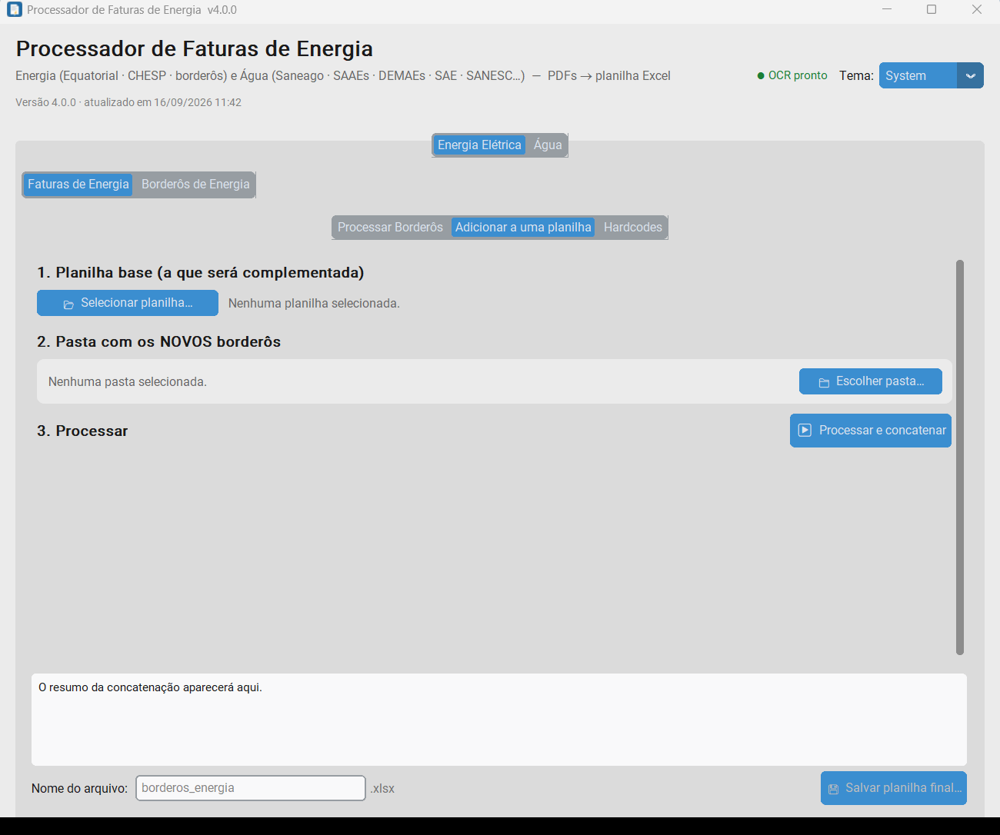

### 1.8 Água — Processar faturas de água (novo na 4.0)

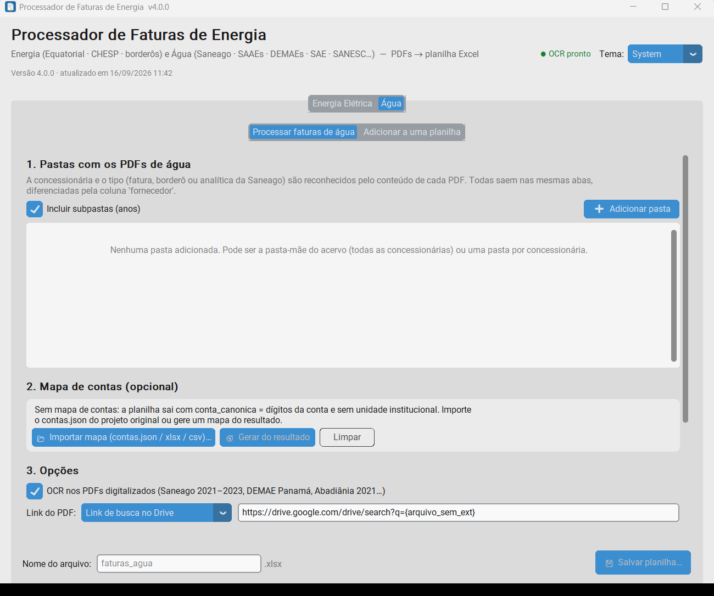

A aba **Água** aceita PDFs de **qualquer concessionária**; não é preciso dizer qual é: o app reconhece pelo conteúdo
(CNPJ e vocabulário) a concessionária e o tipo do documento — fatura individual, **borderô** da Saneago (fatura agrupada
do órgão, com várias contas e retenção de IRPJ) ou **fatura analítica** da Saneago (um bloco por conta). Todas saem nas
**mesmas abas**, diferenciadas pela coluna `fornecedor`.

1. **Pastas com os PDFs de água** — pode ser a pasta-mãe do acervo inteiro (todas as concessionárias, subpastas por ano)
   ou uma pasta por concessionária. *Incluir subpastas (anos)* vem marcado.
2. **Mapa de contas (opcional)** — cadastro *conta → unidade institucional / serviços*. Três botões:
   * **Importar mapa (json / xlsx / csv)…** — o `DICIONARIO_AGUA.json` do TJGO, o `contas.json` do projeto original ou uma planilha
     com colunas parecidas (CONTA_DV, CONTA, UNIDADE, ENDERECO, DISTRIBUIDORA, OPERANTE, AGUA, ESGOTO, SMRSU);
   * **Gerar do resultado** — depois de processar, monta o mapa a partir das próprias faturas (conta, fornecedor, nome,
     endereço, hidrômetro, serviços cobrados); processe de novo para a planilha sair com `conta_canonica` e
     `unidade_institucional`;
   * **Limpar** — remove o mapa ativo. O mapa fica em `%APPDATA%\FaturasEnergia\mapa_contas_agua.json`.
3. **Opções** — *OCR nos PDFs digitalizados* (Saneago 2021–2023, DEMAE Panamá, Abadiânia 2021…; desligue para ir mais
   rápido quando não há PDFs escaneados) e o **Link do PDF** (como na energia).
4. **Processar faturas de água** — barra de progresso, botão *Cancelar* (termina o PDF em andamento) e o log.

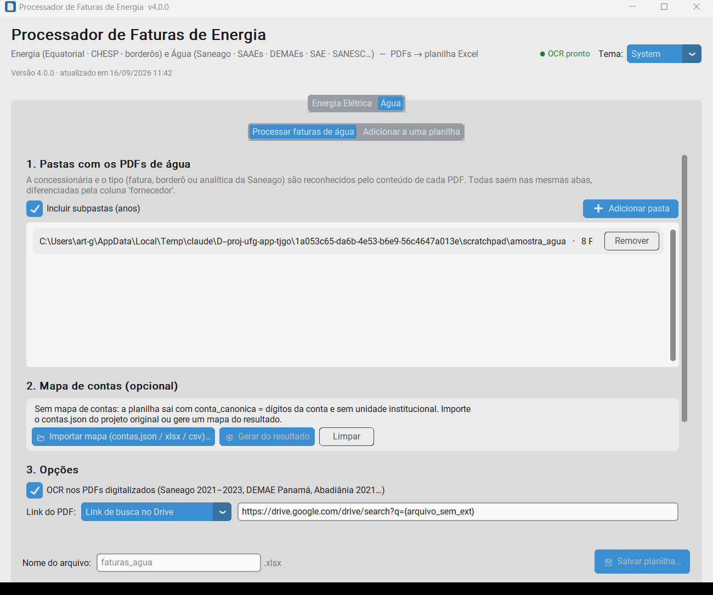

Ao terminar, o rodapé resume o lote e o log mostra, por borderô da Saneago, se a soma das contas confere com o total
impresso, e a quantidade de faturas por concessionária, além dos primeiros erros da validação:

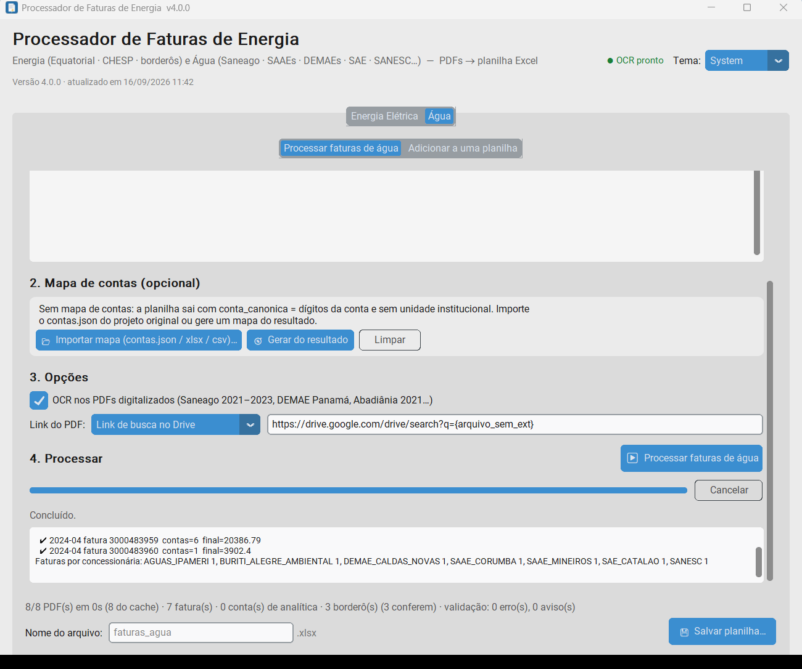

5. **Salvar planilha…** — abas `fatura_agua`, `itens_agua`, `historico_agua`, `borderos_agua`, `contas_bordero_agua`,
   `validacao_agua`, `mapa_contas_agua` (quando há mapa) e `glossario`.

O que significa cada coluna está na aba `glossario` da própria planilha. Pontos de atenção:

* `conta` traz o dígito verificador junto (1627885-2 → `16278852`); `conta_canonica` é a conta sem zeros à esquerda
  (ou a do mapa de contas); `id_fatura_agua` = `<FORNECEDOR>_<nº da fatura>` (SANESC, que não numera: conta + competência).
* `valor_agua` / `valor_esgoto` / `valor_taxas` / `valor_multa_juros` são somas dos lançamentos por categoria;
  `soma_itens` deve bater com `valor_total` (regra **ITENS_NAO_FECHAM** quando não bate).
* `valor_irpj` é o IRPJ retido, negativo como impresso (vazio = a fatura não discrimina IRPJ) e já está dentro de `valor_total` e
  `valor_taxas`; `valor_bruto` é o total sem esse desconto (igual a `valor_total` quando não há IRPJ).
* `observacao` do borderô: `soma por coluna difere do rodapé: …` pede conferência no PDF; `relido por OCR a N dpi para fechar com o
  rodapé` é só informativo. PDFs digitalizados com diferença levam mais tempo, porque são relidos em resolução maior.
* Borderô da Saneago: os valores por conta são **brutos**; `base_calculo` (água + esgoto) × `aliquota_irpj` (4,80 %) =
  `valor_retido`; `valor_final` é o que é pago. `bate_total` = a soma das contas confere com o total impresso.
* A fatura analítica e o borderô da Saneago são o **mesmo dinheiro** (detalhe × agrupado): a validação cruza os dois
  (**ANALITICA_DIVERGE_BORDERO**, **CONTA_SEM_ANALITICA**), mas não some os dois num total.
* PDFs digitalizados vêm marcados com `extraido_por_ocr = True` e a regra **LIDA_POR_OCR** — confira os valores.

### 1.9 Água — Adicionar a uma planilha

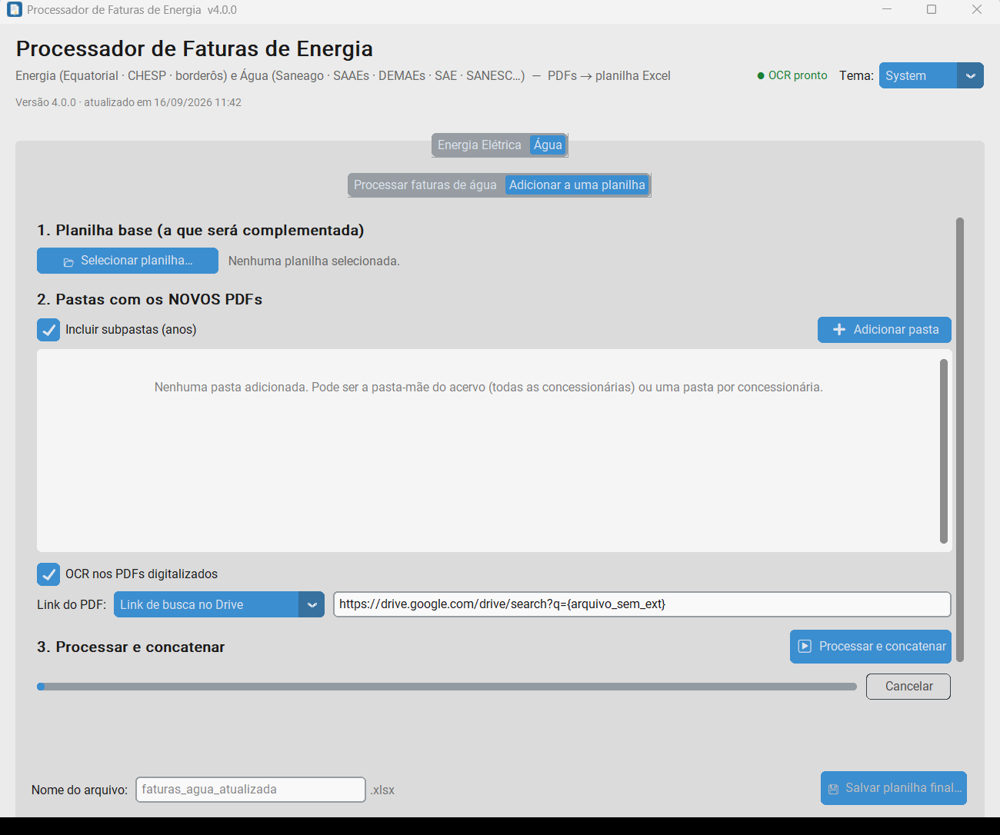

Igual ao fluxo de energia: planilha base de água + pastas com os PDFs novos → **Processar e concatenar** (repetidos, pelo
`id_fatura_agua`/`id_bordero_agua`, ficam de fora) → **Salvar planilha final…**.

### 1.10 Linha de comando (sem abrir o programa)

Na pasta do app há o `FaturasDeEnergiaCLI.exe` (ou, no código-fonte, `python -m faturas_app --cli`):

```bash
FaturasDeEnergiaCLI.exe --cli --pasta "D:\pdfs\equatorial=EQUATORIAL" --pasta "D:\pdfs\chesp=CHESP" --subpastas --saida D:\saida\faturas_energia.xlsx --csv D:\saida\csv
```

```bash
FaturasDeEnergiaCLI.exe --cli --agua "J:\Faturas-Outras-Distribuidoras" --agua "J:\Faturas-Saneago-Bordero" --saida D:\saida\faturas_agua.xlsx --csv D:\saida\csv_agua
```

Opções úteis: `--cache DIR` (só PDFs novos são lidos de novo), `--paralelo N`, `--mapa-uc ARQ` (energia),
`--mapa-contas ARQ` (água), `--sem-ocr` (água), `--log ARQ`. Não misture `--pasta` e `--agua` na mesma execução.

---

## Parte 2 — Site gEEstor (https://unigeestor.emc.ufg.br)

O site é a porta de entrada do banco de dados da sua organização (TJGO, UFG, Polícia Penal, INMETRO). Cada página tem o
link **Preciso de ajuda** no rodapé, e a página **Tutoriais** reúne vídeos curtos de cada tarefa.

### 2.1 Entrar

* **Entrar com login** → usuário e senha → (em login compartilhado) quem está entrando → a organização.
* **Minha conta**: trocar a senha, ver os membros do login, sair de todos os aparelhos.
* **Painel**: situação geral — faturas e borderôs de energia, água por concessionária, alertas da conferência e pendências.
* Sem login, a página **Enviar faturas** funciona como extrator avulso: recebe PDFs e devolve as planilhas, sem guardar nada.

### 2.2 Consultar

| Página | O que mostra |
|---|---|
| **Faturas de energia** | lista com filtros (mês, UC, distribuidora); a página da fatura traz itens, medição, tributos, o PDF, os alertas da conferência e o borderô em que ela aparece |
| **Unidades** | cada unidade consumidora: cadastro do mapa de UCs e as faturas dela |
| **Borderôs** | borderôs de energia e o cruzamento de cada UC com a fatura individual |
| **Água** | faturas por concessionária, contas, borderôs da Saneago (IRPJ, valor final) e o cruzamento borderô × analítica |
| **Conferência** | erros e avisos das regras de validação (energia, água e borderôs), com o glossário de cada regra |
| **Planilhas e PDFs** | planilhas completas (energia, borderôs, água) e os PDFs originais, um a um ou em zip |
| **Power BI** | servidor, banco, usuário de leitura e o passo a passo para ligar o Power BI às views |

### 2.3 Conferência e justificativas

Cada alerta da conferência leva ao documento. Quem abre o PDF e vê que está tudo certo (por exemplo: o total não bate com a
soma dos itens porque há itens só demonstrativos) clica em **Justificar** e escreve o motivo. O alerta sai do quadro, e na
página do documento ficam registrados o alerta, a justificativa, quem justificou e quando. **Justificativas** lista todas e
permite retirar uma (o alerta volta ao quadro). O aprovador da organização pode justificar uma regra inteira de uma vez.

### 2.4 Entrar com PDFs novos

1. **Enviar faturas**: arraste os PDFs (energia, borderôs e água juntos). O site reconhece cada um, roda os extratores
   (PDFs digitalizados passam por OCR), confere duplicidade e se o PDF é mesmo da sua organização, e mostra o resultado
   arquivo a arquivo, com as planilhas para baixar.
2. **Enviar para o banco**: abre uma solicitação. A inserção só acontece depois da **aprovação** do aprovador da organização
   (página **Solicitações**: prévia das linhas novas, Aprovar / Negar). Ao aprovar, o site grava tudo no banco da organização,
   copia os PDFs para o repositório e recompila as views.

### 2.5 Outros

* **Ajuda e pedidos**: assistente que responde dúvidas sobre o site e os dados, e pedidos (chamados) ao administrador,
  com acompanhamento da resposta.
* **Notificações** (sino): solicitações aprovadas ou negadas, respostas de chamados, avisos do administrador.
* Administrador da organização: usuários e membros, mapa de UCs, regras de correção (hardcodes), correção manual de dados
  com histórico e desfazer.

---

## Parte 3 — Desktop × site: quando usar cada um

| | Aplicativo desktop | Site gEEstor |
|---|---|---|
| Onde roda | na sua máquina (Windows), sem internet | na VM (PostgreSQL), pelo navegador |
| Entrada | pastas de PDFs | PDFs enviados pelo navegador; acervo carregado pelo administrador |
| Saída | planilha Excel (+ CSV por aba na CLI) | páginas de consulta, planilhas para baixar, views para o Power BI |
| Energia | faturas Equatorial/CHESP/ENEL, borderôs | idem, com cruzamento borderô × fatura e mapa de UCs no banco |
| Água | todas as concessionárias, mesma planilha; mapa de contas local | mesmas tabelas no banco (`tabelas_agua` / `views_agua`), cruzamento borderô × analítica |
| Histórico/auditoria | não (cada planilha é um arquivo) | sim: snapshots de toda escrita, auditoria, aprovação, justificativas |
| Correções | Parâmetros e Hardcodes locais | hardcodes por organização (só nas views), mapa de UCs, chamados |
| Extrator | o mesmo código (`faturas_app`) | o mesmo código: a branch principal deste repositório, sincronizada automaticamente |
